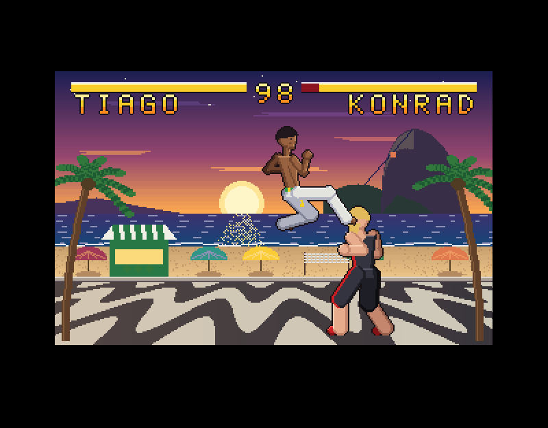

# WorldFight65

A one-on-one fighting game for the MEGA65 in the style of the classic arcade versus fighters, written in
45GS02 assembly (KickAssembler 65CE02 5.25).

**Status:** Stage 3 – a complete match: best of three rounds with timer, crouching, jumping, blocking and knockdowns.



## The plan
- A "world championship": fighters from different countries, each with its own moves, special moves and
  home arena. Tiago (Brazil, capoeira) and Konrad (Germany, wrestling) come first; more fighters follow as
  loadable packages.
- Two players with two joysticks first; a CPU opponent later.
- Best of three rounds, energy bars, round timer, KO and time-over.
- Large fighters (about 64×96 pixels) drawn as RRB objects, artwork and music by Claude.

See [docs/design.md](docs/design.md) for the technical design and the roadmap.

## Build
Requirements: Python 3 with Pillow and NumPy, Java, and `KickAss65CE02-5.25.jar` (not part of
the repository; put it into `tools/bin/` or pass `--kickass`).
```
python3 tools/build.py --kickass /path/to/KickAss65CE02-5.25.jar
```
The output is `build/WORLDFIGHT.PRG` and `build/WORLDFIGHT65.D81`.

## Playing
`LOAD "WORLDFIGHT",8` and `RUN` from `releases/stageN/WORLDFIGHT65.D81`. Needs attic RAM (MEGA65 R3 or newer).
Player 1 (Tiago): joystick port 1; player 2 (Konrad): port 2. Button 1 punches, button 2 (two-button pads)
kicks; holding forward makes it a heavy attack. Up jumps, down crouches (down-forward + button 2: sweep),
holding back blocks. X or RUN/STOP returns to BASIC.

## Stages
Every stage has a release folder `releases/stageN/` (PRG, D81, README, checksums) and notes with a hardware
checklist in `docs/stageN.md`; confirmed stages are tagged `stageN-stable`.

| Stage | Content |
|---|---|
| 0 | repository, working rules, design, build pipeline, D81 test program |
| 1 | Rio arena, Tiago standing and walking, frame streaming from attic RAM, horizontal flip |
| 2 | Konrad, two players, light/heavy punches and kicks, hits, pushback, energy bars, KO |
| 3 | crouching, jumping, blocking, sweeps and knockdowns, rounds, timer, names, banners, win poses |

## Documentation
- [Technical design and roadmap](docs/design.md)
- [Memory map](docs/memory_map.md)
- [Working rules](CLAUDE.md)

## Layout
```
src/       assembly sources
tools/     build.py, d81.py; later art, music and check scripts
assets/    artwork; source/ holds the scripts with which Claude draws the art
docs/      design, memory map, stage notes
releases/  tested stage builds (PRG, D81, README, checksums)
```

## Licence
GPL-3.0, as ShooterMega65 (see `LICENSE`).
